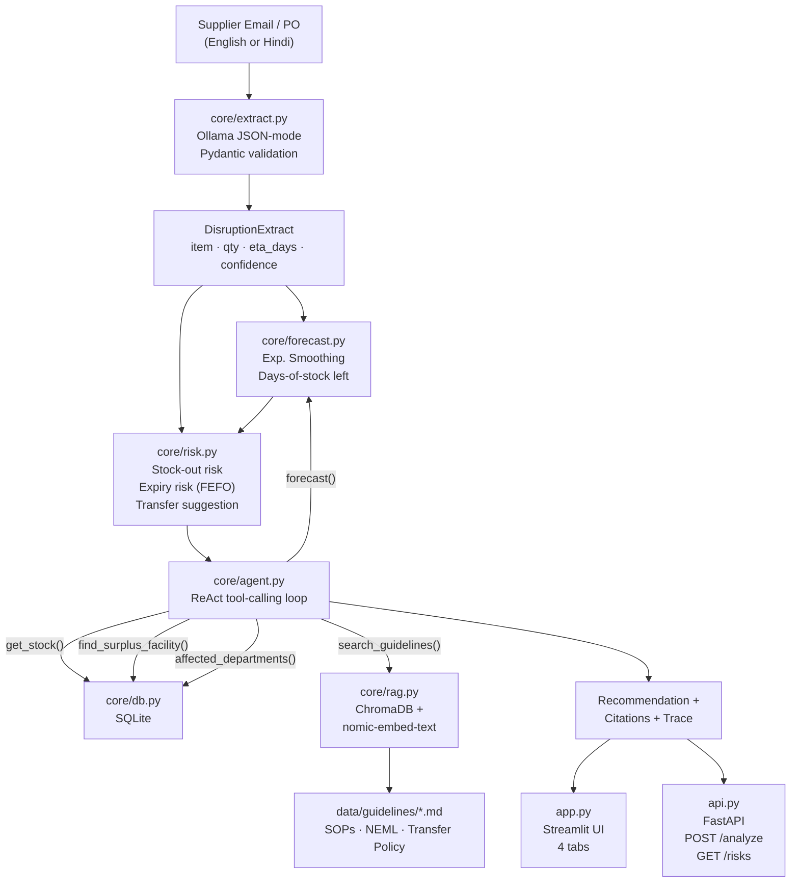

# 🏥 AI Hospital Supply-Chain Disruption Analyst.

> **Hacktoberfest 2026 Submission** · Theme: Open-Source LLMs  
> 100% local · zero paid APIs · MIT License

An AI-powered supply-chain disruption analyst for government district hospitals.
Supplier emails and purchase orders — in **English or Hindi** — are parsed by a
local LLM into structured alerts. A forecasting engine predicts stock-outs, a
risk engine flags HIGH/MEDIUM/LOW risk, and an agent loop writes grounded
recommendations with citations from internal SOPs.

> ⚠️ **Synthetic Data Notice:** All data in this project (stock levels,
> consumption history, supplier emails, facility names) is entirely fictional
> and generated for demonstration purposes only. No real patient data,
> procurement records, or supplier information is used anywhere.

---

## 🎯 Problem

Public hospitals in India face three interlinked supply-chain failures:

| Problem | Impact |
|---|---|
| Supplier shipment delays (strikes, floods, QC holds) | Stock-outs mid-treatment |
| Manual tracking of supplier emails | Delays propagate unnoticed |
| Expiry waste (FIFO instead of FEFO) | Budget loss + stock-outs |

Staff receive messy supplier emails they cannot quickly convert into a risk
picture — "which ward runs out first? Can Facility B cover us?"

---

## 🏗️ Architecture



---

## 🔧 Open-Source Stack

| Component | Library / Model | License |
|---|---|---|
| LLM inference | [Ollama](https://ollama.com) + **Qwen2.5:7b** | MIT / Apache-2.0 |
| Embedding | **nomic-embed-text** via Ollama | Apache-2.0 |
| Vector DB | [ChromaDB](https://www.trychroma.com) | Apache-2.0 |
| Relational DB | SQLite (stdlib) | Public Domain |
| UI | [Streamlit](https://streamlit.io) | Apache-2.0 |
| REST API | [FastAPI](https://fastapi.tiangolo.com) | MIT |
| Data / Forecast | pandas · statsmodels | BSD |
| Validation | pydantic v2 | MIT |
| Config | PyYAML | MIT |

**No OpenAI, Anthropic, Cohere, or any paid API is used.**

### Model License Notes
- **Qwen2.5**: Apache-2.0 (default, unrestricted commercial use).
- **Gemma 3**: Google Gemma Terms of Use (non-commercial restrictions apply).
- **Llama 3.1**: Meta Llama 3 Community License (usage limits for large deployments).
- Swap model in `config.yaml` — no code changes needed.

---

## 🚀 Quick Start (Local, No Docker)

### Prerequisites

```
[ ] Python 3.11+    : python --version
[ ] pip             : pip --version
[ ] Ollama          : ollama --version   (install: https://ollama.com/download)
[ ] Ollama running  : ollama list
```

### Setup

```bash
# 1. Clone
git clone https://github.com/your-username/hospital-supply-chain-analyst
cd hospital-supply-chain-analyst

# 2. Install dependencies
pip install -r requirements.txt

# 3. Pull models (≈5 GB download)
ollama pull qwen2.5:7b
ollama pull nomic-embed-text

# 4. Seed database + build RAG index
python seed.py

# 5. Launch UI
streamlit run app.py
```

Open **http://localhost:8501** in your browser.

To also run the REST API:
```bash
uvicorn api:app --reload --port 8000
# Docs: http://localhost:8000/docs
```

---

## 🐳 Docker (One-Command Start)

```bash
docker compose up --build
```

This starts:
- `ollama` service (model server)
- `model_puller` (pulls qwen2.5:7b + nomic-embed-text, then exits)
- `seeder` (seeds DB + RAG index, then exits)
- `streamlit` → http://localhost:8501
- `api` → http://localhost:8000/docs

---

## 🎬 Demo Scenario (< 60 seconds)

1. Open the **Analyse Email** tab
2. Select **"🚚 Insulin delay (English)"** from the dropdown (or paste manually):

   ```
   Insulin shipment delayed by 9 days due to transport strike.
   ```

3. Click **Analyse**. The system will:
   - **Extract**: `item=Insulin, new_eta_days=9, reason=transport strike`
   - **Forecast**: ~150 units on hand ÷ ~31 units/day ≈ **4.8 days of stock**
   - **Risk**: stock-out in ~5 days, replacement in 9 days → **HIGH RISK**
   - **Transfer**: recommends transfer from Facility-B (900 vials)
   - **Agent**: calls 5 tools, cites SOP-SC-001 and NEML-2025, writes recommendation
   - **Flag**: "⚠️ FLAG FOR HUMAN REVIEW"

4. Switch to the **Hindi** sample to test multilingual extraction.
5. Check the **Agent Trace** tab for full tool-call transparency.

---

## 🧪 Running Tests

```bash
pytest tests/ -v
```

Tests run without Ollama (LLM calls are mocked). Expected output:

```
tests/test_db.py        ::  12 passed
tests/test_extract.py   ::  11 passed  (includes 3 malformed-LLM tests)
tests/test_forecast.py  ::  8 passed
tests/test_risk.py      ::  12 passed
```

---

## ⚙️ Swapping the Model

Change one line in `config.yaml`:

```yaml
ollama:
  chat_model: "gemma3:4b"     # or llama3.1:8b, mistral:7b, etc.
  embed_model: "bge-m3"       # better Hindi support
```

Then: `ollama pull gemma3:4b && ollama pull bge-m3`

No code changes required anywhere.

---

## 📡 REST API

```bash
# Health check
curl http://localhost:8000/health

# Analyse an email
curl -X POST http://localhost:8000/analyze \
  -H "Content-Type: application/json" \
  -d '{"raw_text": "Insulin delayed 9 days.", "facility_id": "Facility-A"}'

# Risk table for a facility
curl http://localhost:8000/risks/Facility-A
```

Full OpenAPI spec: **http://localhost:8000/docs**

---

## 📈 Scalability Notes

| Scale | Approach |
|---|---|
| **Per-item parallel forecasting** | Use `concurrent.futures.ThreadPoolExecutor` in `_build_dashboard_df` |
| **Batch email extraction** | Submit emails as a queue; one LLM call per email, can be parallelised |
| **Multiple facilities** | Already modelled — `facility_id` is a first-class dimension in all queries |
| **District → State rollup** | Aggregate risk assessments by facility group; add a `district_id` FK |
| **SQLite → PostgreSQL** | Change `sqlite_path` to a `DATABASE_URL`; swap `sqlite3` for `psycopg2` in `db.py` |
| **pgvector** | Replace ChromaDB with `pgvector` for unified DB; change `rag.py` connection |
| **Model scale-up** | Swap to `qwen2.5:72b` or serve via vLLM for GPU clusters |
| **Async FastAPI** | Convert `api.py` endpoints to `async def` + `httpx.AsyncClient` |

---

## 🗺️ Roadmap

- [ ] **District dashboard** — aggregate risk across all facilities
- [ ] **Whisper voice notes** — "Paracetamol finished in Ward 3" → stock update
- [ ] **OCR** — scan physical stock registers with PaddleOCR/Tesseract
- [ ] **Automated alerts** — email/SMS when HIGH risk detected
- [ ] **Procurement integration** — auto-draft PO on HIGH alert
- [ ] **pgvector migration** — for deployments with existing Postgres
- [ ] **Hindi UI** — full Streamlit interface in Hindi

---

## 🔌 How to Extend

### Add a new data source (e.g., SMS alerts)
1. Add a new seed function in `seed.py`
2. Call `extract_disruption()` on each SMS text — no other changes needed

### Add a new tool to the agent
1. Add a function `_tool_new_thing(...)` in `core/agent.py`
2. Register it in `_TOOLS` dict
3. Update `_SYSTEM_AGENT` prompt to describe the new tool

### Add new guideline documents
1. Drop a `.md` file into `data/guidelines/`
2. Run `python seed.py --reset` (or `build_index(force=True)`)
3. The RAG system indexes it automatically

### Connect a new frontend
Hit `POST /analyze` on the FastAPI layer — returns structured JSON with
extraction, forecast, risk, recommendation, and citations.

---

## ⚠️ Limitations

- LLM extraction confidence varies by email complexity and model size
- Forecasting assumes stable consumption patterns; spikes (epidemics, mass
  casualty events) require manual override
- The agent uses ReAct text parsing (not native tool-calling format) for
  compatibility with all Ollama models
- RAG retrieval quality depends on embedding model quality
- All recommendations require human review before action

---

